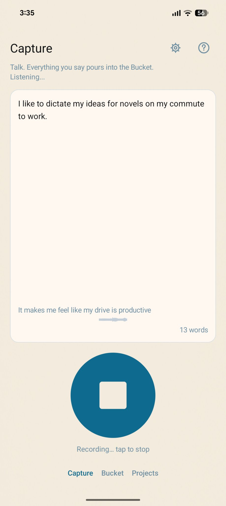
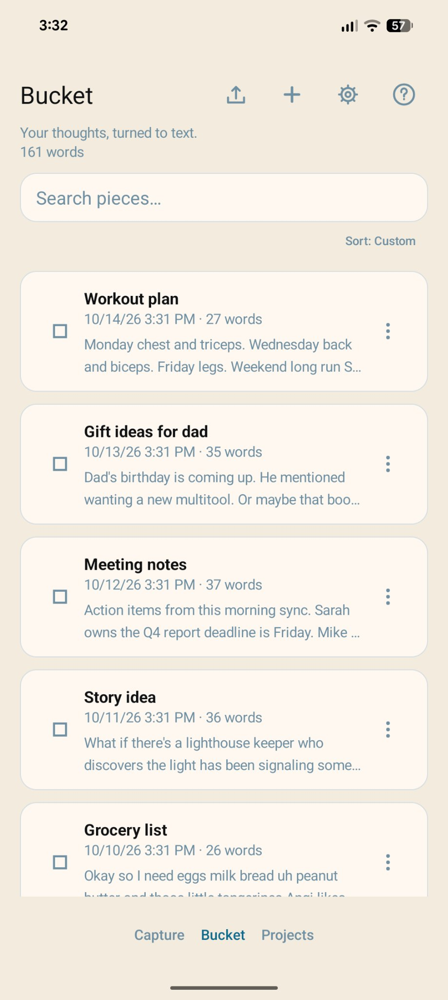
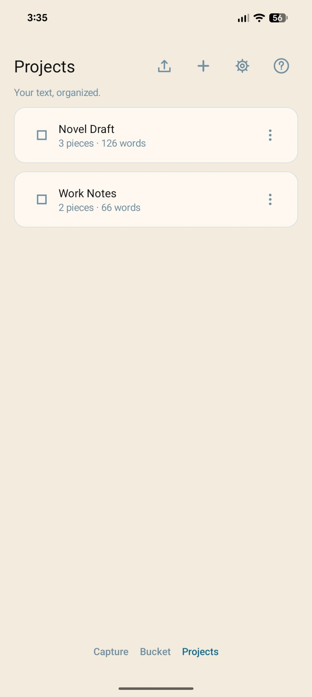
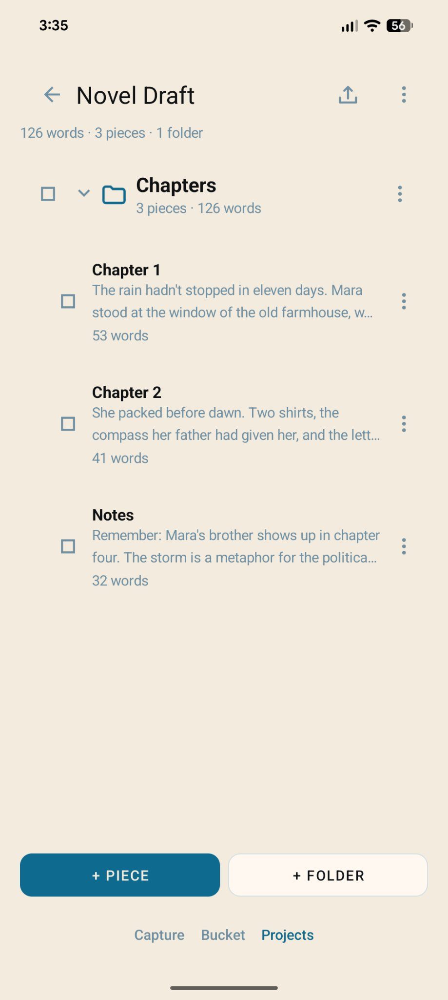
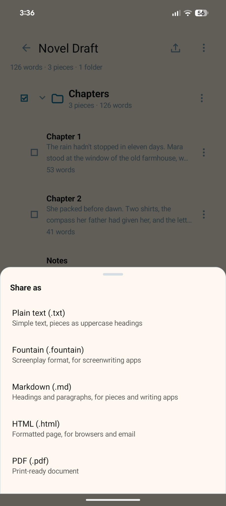
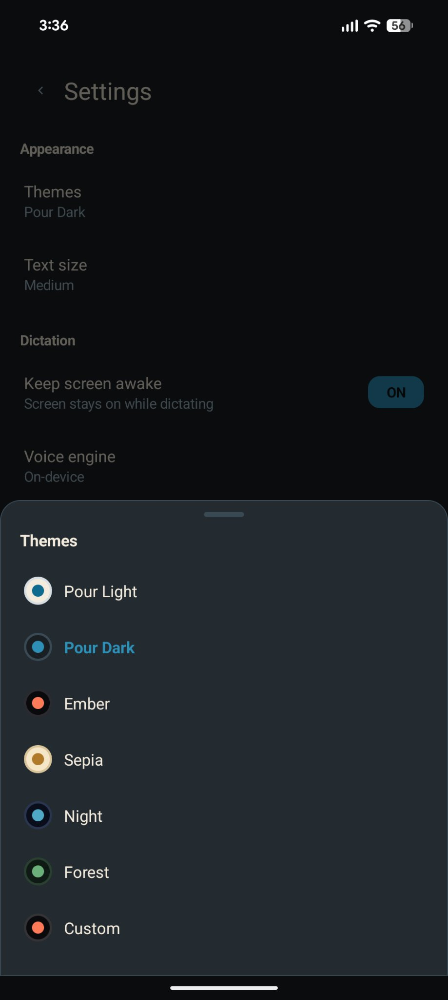

# Pour

**Speak, and Pour writes it down.** Turn thoughts into words you can keep and send anywhere.

Pour is a free, open-source voice dictation app for Android. Fully offline. No accounts, no cloud, no subscriptions. Your words stay on your device.

## Features

- **Voice dictation** — tap to talk, Pour transcribes in real time using an on-device speech model
- **Bucket** — a quick-capture inbox for stray thoughts
- **Projects** — organize pieces into projects with folders
- **Themes** — Pour Light, Pour Dark, Sepia, Night, Forest, Ember, and custom
- **Export** — Plain Text, Markdown, Fountain (for screenwriters), HTML, and PDF
- **Trash** — deleted pieces go to Trash first, with configurable auto-delete
- **Backup & restore** — full library backup to a single file

## Screenshots

| Capture | Bucket | Projects |
|---|---|---|
|  |  |  |

| Project detail | Share | Themes |
|---|---|---|
|  |  |  |

## Building

Pour is a native Android app (Java, no Gradle — builds with a shell script).

**Prerequisites:**
- JDK 17
- Android SDK (platform android-35, build-tools 35.0.1)

**Build:**
```bash
ABIS=arm64-v8a ./build-release-apk.sh
```

The APK will be at `pour-1.0.25-arm64-v8a-release.apk`.

**Signing:** The release build expects a keystore. See `build-release-apk.sh` for details.

## Speech Model

Pour uses the Kroko Zipformer speech recognition model, which downloads on first launch. The model is licensed CC-BY-SA. Speech recognition is powered by Kroko.

## License

Pour is free software: you can redistribute it and/or modify it under the terms of the GNU General Public License as published by the Free Software Foundation, either version 3 of the License, or (at your option) any later version.

See [LICENSE](LICENSE) for the full text.

## Contributing

Pull requests welcome. Please keep the code style consistent (native Java, programmatic UI, no external dependencies beyond sherpa-onnx).
